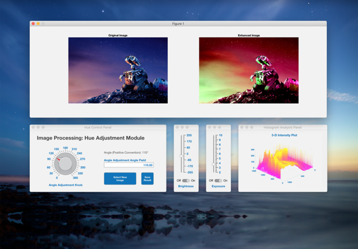

   
<b>ImTune</b>

 

### Features
- Built programatically using MATLAB
- Takes any image file and allows the hue to be calibrated through the adjustment knob
 

### Languages/Frameworks
&nbsp;&nbsp;&nbsp;&nbsp;&nbsp;&nbsp;&nbsp;&nbsp;&nbsp;&nbsp;&nbsp;&nbsp;&nbsp;&nbsp;&nbsp;&nbsp;&nbsp;&nbsp;&nbsp;&nbsp;&nbsp;&nbsp;&nbsp;&nbsp;&nbsp;

 

### Project Files 
[ImTune Source Files](https://github.com/MichaelTroeung/ImTune/tree/main)&nbsp;&nbsp;&nbsp;&nbsp;&nbsp;&nbsp;&nbsp;&nbsp;&nbsp;&nbsp; [MacOS Build [dmg]](https://github.com/MichaelTroeung/ImTune/releases/download/Release/ImTune.app.zip)&nbsp;&nbsp;&nbsp;&nbsp;&nbsp;&nbsp;&nbsp;&nbsp;&nbsp;&nbsp;

MacOS [.dmg] installer available above. <b> NOTE: On MacOS right click and open to override warning. </b>

